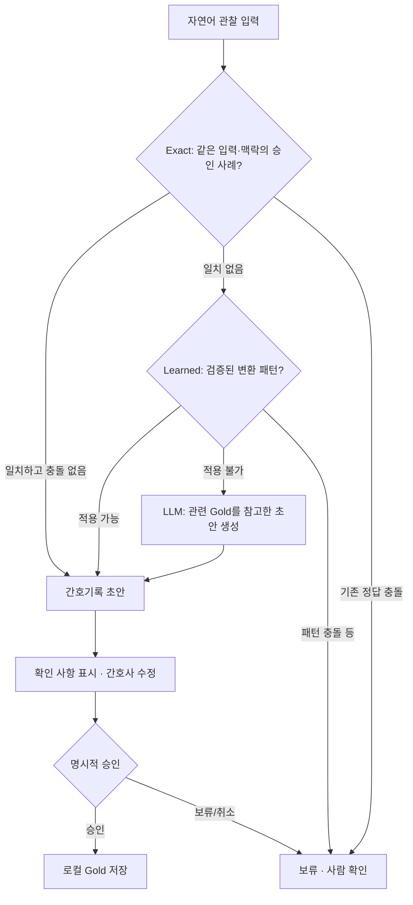

# AI-assisted Nursing Charting PoC

**자연어 관찰 → 간호기록 초안 → 간호사 검토·승인 → 기준 사례(Gold) 축적**

> **Status:** 개인 개발 Proof of Concept · 합성 데이터 전용 · 로컬 실행 · 실제 임상 사용 불가

중환자실·심혈관계 임상에서 반복적으로 작성하는 간호기록을 어떻게 보조할 수 있을지 탐색한 프로젝트입니다. 간호사가 평소 사용하는 짧은 자연어와 약어를 기록 초안으로 바꾸고, **사람의 검토를 거친 결과만 다음 생성의 기준 사례로 활용**하도록 설계했습니다.

의료 AI에서 중요한 것은 문장을 생성하는 것만이 아니라 **입력 사실을 보존하고, 불확실한 내용을 드러내며, 사람이 확인·수정할 수 있게 하는 과정**이라고 생각했습니다.

## 해결하려는 문제

- 기록 작성 시 관찰 내용을 반복적으로 정리하고 표현을 다듬어야 하는 부담
- 동일한 상황에서도 표현이 달라지는 기록의 일관성 문제
- 생성형 AI가 입력에 없는 상태·처치·수치 등을 보충하거나 애매한 내용을 확정할 위험

**목표:** 작성 업무를 보조하되, AI의 출력을 최종 간호기록으로 자동 확정하지 않는 작업 흐름을 구현하는 것입니다. 업무시간 절감이나 임상적 정확도 개선은 아직 입증하지 않았습니다.

## 처리 구조



| 단계 | 구현 목적 | 제한 및 확인 사항 |
| --- | --- | --- |
| **Gold** | 자연어 입력과 기준 기록을 짝지어 보관하는 참조 사례 | 이름만으로 임상적 정답성을 보증하지 않음 |
| **Exact** | 동일 입력·맥락의 기록을 재사용 | 같은 입력에 서로 다른 정답이 있으면 보류 |
| **Learned** | 여러 승인 사례에서 근거가 확인된 수치·문구 패턴 적용 | 일반적인 의미 이해나 모델 미세조정이 아님; 충돌 시 사용 제한 |
| **LLM fallback** | 앞선 방법이 처리하지 못한 입력의 초안 생성 | 관련 Gold는 문체 참고용이며 현재 환자 사실의 근거가 아님 |
| **Human review** | 초안 수정, 불확실성 확인, 명시적 승인 | 승인 전에는 Gold에 자동 추가하지 않음 |

LLM 출력에는 구조화된 필드와 입력 인용 근거를 요구하며, 일부 수치·단위 표기를 규칙 기반으로 점검합니다. **이는 구조·표기 수준의 검사이지 임상 의미의 자동 검증은 아닙니다.** 특히 누락, 부정 표현, 시행과 계획의 구분, 기록의 적절성은 간호사가 확인해야 합니다.

## 실제 구현

- Python 기반 CLI와 로컬 웹 UI (EMR 미연동, `127.0.0.1`에서 실행)
- Exact → Learned → LLM 단계별 처리 및 적용 경로 표시
- 기존 Gold 충돌 시 자동 확정 대신 보류·검토
- 초안 편집, 확인 사항 표시, 승인 후 Gold 저장
- 합성 입력 생성 및 순차 검토 대기열 (외부 API 호출·비용 발생 가능)

## 공개 데모: 합성 예시 3건

이 저장소의 `examples/public-demo-gold.json`은 **공개 시연용으로 별도 작성한 가상 사례 3건**입니다. 개인 개발 환경의 원본 Gold, 분류 검토 자료, 실험 데이터는 포함하지 않습니다. 공개 예시는 임상 전문가가 검증한 정답 데이터셋이 아닙니다.

**Exact 재사용 예시**

| 자연어 입력 | 저장된 기준 기록 |
| --- | --- |
| 체온 36.8도 측정함. 통증 없다고 말함. | BT 36.8℃ 측정됨. 통증 없다고 진술함. |

이 결과는 **Gold를 정확히 재사용하는 경로**의 시연이지, LLM의 새로운 문장 생성 능력을 평가한 결과가 아닙니다. 공개 데모의 Gold가 적으므로 Learned 패턴이 활성화되지 않을 수 있습니다.

## 로컬 실행 방법

**환경:** Windows / Python 3.12 이상. 별도 Python 서드파티 패키지 설치 없이 실행할 수 있습니다.

**API 키 없이 Exact 확인하기** — 저장소 최상위 폴더의 PowerShell에서 실행:

```powershell
python -m nursing_charting.backup restore --backup examples/public-demo-gold.json
python -m nursing_charting learn
python -m nursing_charting.web
```

브라우저 주소창에서 `http://127.0.0.1:8765/`을 직접 열고 위 자연어 문장을 입력한 뒤 **합성 입력** 확인란을 선택해 생성하면 `Exact` 경로를 확인할 수 있습니다. 복원 명령은 기존 로컬 Gold 파일이 있다면 덮어쓰지 않고 중단합니다.

**LLM 초안 생성까지 사용하기:** `start_windows.cmd` 실행 시 개인 OpenAI API 키를 설정할 수 있습니다. 키는 로컬 `.env`에 저장되므로 절대 공유하지 마세요. 외부 모델 호출에는 접근 권한과 사용료가 필요하며, 실제 환자정보를 입력해서는 안 됩니다. 서버 종료는 터미널에서 `Ctrl+C`입니다.

## 검증 범위와 현재 한계

| 확인된 것 | 아직 검증되지 않은 것 |
| --- | --- |
| 공개 합성 Gold 3건 복원 | 실제 임상 기록의 정확성·안전성 |
| 동일 입력의 Exact 기록 재사용 | 새로운 표현에 대한 충분한 일반화 성능 |
| 로컬 웹 UI 기동 및 초안 표시 | 실제 간호기록 작성 시간 감소 |
| 임상적 충돌·불확실성을 다루기 위한 코드 경로 구현 | 모든 유형의 임상적 환각·누락 자동 탐지 |
| 사람의 수정·승인 절차 구현 | EMR 연동 및 현장 배포 |

개인 개발 환경에서는 더 많은 합성 Gold를 이용해 표현 일관성, 수치 패턴, 충돌 보류를 탐색했지만, **그 실험 결과를 공개용 3건 데모의 성능 수치로 제시하지 않습니다.** Learned가 보수적으로 작동해 적용 가능한 패턴이 적거나 충돌로 보류되는 문제 역시 개선 대상입니다.

## 다음 개선 과제

1. 합성 Gold의 범위·표현 다양성 확대와 충돌 검토
2. 숫자·단위·부정·시간 순서·시행/계획 차이에 대한 사례별 평가셋 구축
3. 초안 품질에 대한 사람의 판정 기준과 재현 가능한 평가 절차 정리
4. 사용자 검토 과정과 기록 작성 소요 시간 측정

## 프로젝트에서 수행한 역할

임상 경험을 바탕으로 문제와 사용 시나리오를 정의하고, 합성 기록 사례를 작성·검토했습니다. 또한 입력 사실 보존, 보류 기준, 승인 절차 등 품질 요구사항을 구체화하고 반복 테스트를 수행했습니다. **구현 과정에는 AI 코딩 도구를 활용**했습니다.

이 프로젝트는 완성된 의료기기가 아니라, **의료 현장의 요구사항을 AI 기능·검토 절차·품질 평가 항목으로 구체화하는 과정**을 보여주기 위한 PoC입니다.

---

**안전·공개 범위:** 실제 환자정보 사용 금지 · EMR 연결 없음 · 공개용 합성 사례만 포함 · 비공개 개발 데이터 및 API 키 미포함 · 임상적 사용 불가
